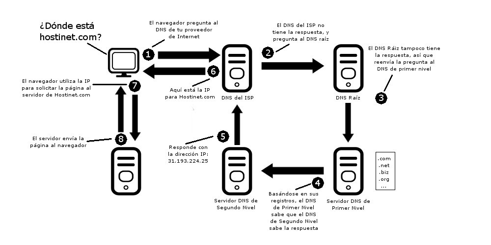
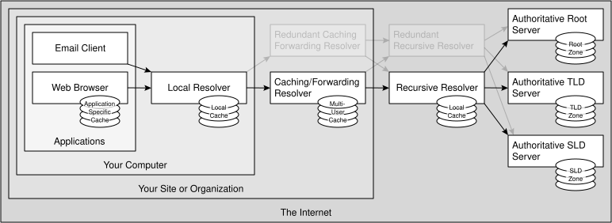
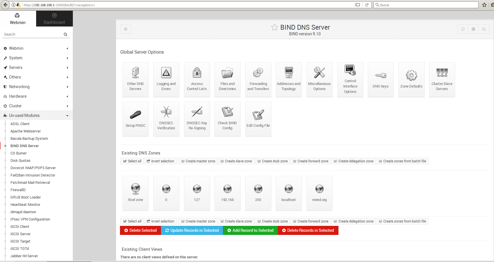
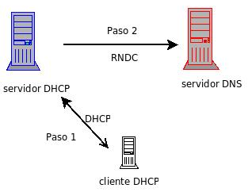

SERVIDOR DNS
============

PREGUNTAS DNS
-------------

 01. **¿En qué consiste DNS? ¿Qué puertos y protocolo en la capa de transporte utiliza?**

     DNS funciona sobre UDP y algunas veces sobre TCP, utilizando el puerto 53.

     La función más conocida de los protocolos DNS es la asignación de nombres a direcciones IP. Por ejemplo, si la dirección IP del sitio FTP de prox.es es 200.64.128.4, la mayoría de la gente llega a este equipo especificando ftp.prox.es y no la dirección IP. Además de ser más fácil de recordar, el nombre es más fiable. La dirección numérica podría cambiar por muchas razones, sin que tenga que cambiar el nombre.

     Cada dominio debe tener un servidor DNS autorizado responsable de dicho dominio (también llamado zona de autoridad), que a su vez puede tener otros servidores DNS autorizados responsables de subdominios. De tal manera el servicio de DNS queda distribuido, sin un registro central donde consultar o actualizar cambios. La información de los nombres de máquinas está repartida por todos los servidores de DNS del mundo.

     Si un cliente formula una pregunta recursiva a un servidor DNS, éste debe intentar por todos los medios resolverla aunque para ello tenga que preguntar a otros servidores. Si, en cambio, el cliente formula una pregunta iterativa a un servidor DNS, este servidor devolverá o bien la dirección IP si la conoce o si no, la dirección de otro servidor que sea capaz de resolver el nombre.

     

     Nombre de dominio = nombre de máquina + subdominios + dominio de nivel superior

     www.xtec.cat = www (nombre de máquina) + xtec (subdominio) + cat (dominio nivel superior)

 02. **¿Qué es un servidor DNS primario? ¿Qué es un servidor DNS esclavo? ¿Qué es un servidor DNS caché?**

     Los tres responden a peticiones de DNS.

     Los servidores DNS primarios o maestros guardan los datos de uno o más espacios de nombres en sus ficheros, que utilizan para resolver las peticiones de información sobre dichas zonas.

     Los servidores DNS secundarios o esclavos obtienen la base de datos para la resolución de nombres desde los servidores primarios a través de una transferencia de zona, y mantienen dicha copia actualizada y la utilizan para resolver las peticiones de información sobre dichas zonas.

     Los servidores DNS locales o caché no contienen la base de datos para la resolución de nombres, sino que cuando se les realiza una consulta, estos a su vez consultan a los servidores DNS correspondientes, almacenando la respuesta en su base de datos para agilizar la repetición de estas peticiones en el futuro.

 03. **En una pequeña red local ¿Cómo resuelve el servidor de DNS el nombre de una máquina externa a la red? ¿Cómo resuelve el servidor de DNS el nombre de una máquina interna de la red?**

     El servidor local de DNS resolverá el nombre de una maquina externa a la red reenviando la pregunta a otro servidor, mientras que resolverá el nombre de la máquina interna utilizando su lista de nombres asociados a IPs.

     De todas maneras, el cliente antes de enviar su petición al servidor de DNS intentará resolverla mediante el fichero hosts y mediante su caché de DNS.

     

 04. **¿Viene algún software de servidor de DNS con Windows Server? ¿Desde dónde se instala y desde dónde se administra?**

     Se instala desde *"Agregar y quitar programas -> Agregar y quitar componentes de Windows -> Servicios de red -> Sistema de Nombres de Dominio (DNS)"*.

     Se administra desde *"Herramientas Administrativas -> DNS"*.

 05. **¿Cuál es el software de servidor de DNS más conocido para Unix/Linux?**

     *[Bind](https://www.isc.org/bind/)* del ISC, pero hay otros más sencillos como *[dnsmasq](https://thekelleys.org.uk/dnsmasq/doc.html)*, que además integra el servicio de DHCP con el de DNS.

 06. **¿Qué son los registros A, AAAA, CNAME, NS, MX, PTR y SOA?**

     En la configuración de una zona, los registros más importantes son:
     - A: traduce nombres de hosts a direcciones IPv4.
     - AAAA: traduce nombres de hosts a direcciones IPv6.
     - CNAME: Se usa para crear nombres de hosts adicionales, o alias.
     - NS: Asocia un nombre de dominio a los servidores de nombres de dicho dominio.
     - MX: Asocia un nombre de dominio a los servidores de intercambio de correo del dominio.
     - PTR: funciona a la inversa del registro A, traduciendo IPs en nombres de dominio.
     - SOA: Proporciona información sobre la zona.

     Puedes consultar la lista de todos los posibles registros en: <https://en.wikipedia.org/wiki/List_of_DNS_record_types>

 07. **Al instalar un servidor de DNS en una red local, ¿Qué parámetros a configurar piensas que serán los más importantes?**

     - Nombre de dominio.
     - Nombre de los equipos asociado a sus correspondientes IPs.
     - Nombre del servidor de correo.
     - IP del servidor de DNS para la resolución de nombre externos a la red.

 08. **Al instalar un servidor de DNS en una red local, ¿Qué pruebas piensas que deberás hacer para comprobar el buen funcionamiento?**

     a) Comprobar que cliente y servidor tienen conectividad: están en la misma red física y con IPs de la misma red lógica. ¿Se puede hacer ping de una IP a la otra (sin cortafuegos bloqueando)?

     b) Comprobar que el servidor ha arrancado, observando la tabla de procesos, los puertos en escucha, o la bitácora del sistema. Hay que tener en cuenta que si el fichero de configuración de una zona que está incorrecto, el servidor arrancará igualmente y servirá información del resto de zonas menos la incorrecta.

     c) Comprobar que la máquina des de la que probaré el servicio tiene configurado como su servidor de DNS la IP del servidor que hemos instalado, tanto si realizo las pruebas des de otra máquina cliente como si las realizo des del mismo servidor.

     d) Probar diferentes registros, directos e inversos, de diferentes zonas que sirve el servidor, mediante las herramientas ping, dig o nslookup. Comprobar que las respuestas son correctas.

     e) Probar otras zonas que no sirve el servidor, para comprobar que reenvía las preguntas.

 09. **¿De qué tres maneras se puede integrar el servicio de DHCP con el de DNS para conseguir que el servidor de DNS resuelva nombres de máquinas cuya IP fue dada por un servidor de DHCP?**

     a) Las IPs pueden estar reservadas a las MAC, y por lo tanto DHCP siempre da las mismas.

     b) Con un servidor DNS dinámico, y un servidor DHCP que de la dirección del servidor DNS dinámico. Cuando un cliente reciba los parámetros IP del servidor de DHCP, lo anunciará al servidor DNS dinámico.

     c) Con algún programa que ya traiga un servidor de DNS y DHCP integrados.

 10. **¿Para qué sirve el fichero hosts? ¿Y el caché DNS del cliente? ¿Cómo se vacía la caché de DNS del cliente en Windows, MacOS X y Linux?**

     El fichero de texto `hosts` se utilizaba -y todavía se utiliza- para asociar en un cliente nombres de máquinas a IP. Los clientes consultan este fichero antes de lanzar una petición a un servidor DNS. En Linux dicho archivo se encuentra en `/etc/hosts` y en Windows está en `C:\Windows\System32\drivers\etc\hosts`.

     La caché-DNS del cliente se utiliza para guardar respuestas de peticiones DNS anteriores. Los clientes también consultan dicha caché antes de lanzar una petición a un servidor DNS.

     La caché de DNS en el cliente se vacía reiniciando la máquina o bien escribiendo el comando:

     - En Windows: `ipconfig /flushdns`
     - En MacOS X: `dscacheutil -flushcache`
     - En Linux: `systemctl restart nscd` o bién `systemd-resolve --flush-cache`

DATOS DE LA PRÁCTICA DNS
------------------------

Nuestro servidor de DNS será un servidor primario para búsquedas directas.

Nuestra red se llama *mired.org*.

Los nombres que el servidor de DNS servirá son:

  - *obelix* (cliente con reserva DHCP): IP 192.168.100.150

  - *asterix* (servidor): IP 192.168.100.2

  - *panoramix* (router): IP 192.168.100.1

El servidor de correo será *asterix*, que también se llamará *www*, *ftp* y *mail*.

El servidor de nombres será *asterix*, que también se llamará *dns*.

Una vez realizado el ejercicio necesitaremos asegurarnos que el servidor de DHCP esté sirviendo a los clientes la IP del servidor de DNS que hemos configurado.

También deberemos asegurarnos de que los servidores cuyos parámetros IP se han configurado manualmente (DHCP, router), también tengan configurada la dirección IP del servidor de DNS que hemos instalado para que puedan acceder a los equipos de nuestra red por su nombre.

PRÁCTICA DNS WINDOWS
--------------------

Instalaremos DNS para Windows Server. Exploraremos la interfaz gráfica de administración del servidor DNS, configurando los parámetros básicos. Configuraremos DNS para una pequeña red local y probaremos el servidor.

 01. Manipula la configuración de las tarjetas de red de las máquinas virtuales del servidor y el cliente para que compartan la misma red interna.

 02. Instala y configura el servidor DHCP. Paso a paso , para Windows 2022:

     <https://www.solvetic.com/tutoriales/article/9825-configurar-servidor-dns-windows-server-2022/>

 03. Configura el servidor de DHCP para que incluya dirección del nuevo servidor de DNS entre los parámetros que da a los clientes.

 04. Prueba el servicio de DNS desde un cliente, tanto para direcciones internas como externas.

PRÁCTICA DNS LINUX
------------------

Instalaremos DNS para Linux (Debian 13). Exploraremos el fichero de configuración. Configuraremos DNS para una pequeña red local y probaremos el servidor.

  - <https://www.howtoforge.com/how-to-setup-dns-server-with-bind-on-ubuntu-22-04/>

  - <https://www.digitalocean.com/community/tutorials/how-to-configure-bind-as-a-private-network-dns-server-on-debian-9>

  - <https://wiki.debian.org/Bind9>

 01. Instalamos y configuramos el servidor DNS:

         # apt update
         # apt install bind9

     Aunque el servidor se llama Bind9, el programa que se ejecuta se llama *named*, y el usuario que lo ejecuta se llama *bind*. Vigila que al crear ficheros de configuración de zona dicho usuario tenga los permisos pertinentes para leer y para escribir registros en ellos.

     Editamos los servidores de DNS externos para reenviar consultas:

         # nano /etc/bind/named.conf.options

             options {
               directory "/var/cache/bind";
               forwarders { 8.8.8.8; };
               dnssec-validation no;     # Por problemas dns-caché de mi instituto
             };

     Especificamos donde está el archivo para búsquedas directas:

         # nano /etc/bind/named.conf.local

             zone "mired.org" {
               type master;
               file "/etc/bind/db.mired.org";
             };

     Editamos el archivo para búsquedas directas:

         # nano /etc/bind/db.mired.org

             $ORIGIN mired.org.
             $TTL 1D
             @           IN   SOA     dns admin ( 1  8H  1H  1W  1D )

             @           IN   NS      asterix
             @           IN   MX 10   asterix

             @           IN   A       192.168.100.2

             panoramix   IN   A       192.168.100.1
             asterix     IN   A       192.168.100.2
             obelix      IN   A       192.168.100.150

             router      IN   CNAME   panoramix
             www         IN   CNAME   asterix
             mail        IN   CNAME   asterix
             dns         IN   CNAME   asterix

     y a continuación reiniciamos el servicio:

         # systemctl restart bind9

     Si parece que el servicio no funciona y es difícil detectar si hemos escrito mal la configuración, podemos probar con:

         # ss -plunt | grep named
         # journalctl -e -u named
         # named-checkconf
         # named-checkzone mired.org /etc/bind/db.mired.org

     Si quieres profundizar lee el [capítulo sobre sintaxis y parámetros del fichero de configuración de zona del manual de referencia de Bind](https://bind9.readthedocs.io/en/latest/chapter3.html) y también la [documentación de Bind de RedHat](https://docs.redhat.com/en/documentation/red_hat_enterprise_linux/10/html/managing_networking_infrastructure_services/setting-up-and-configuring-a-bind-dns-server).

     Me gustaría parar aquí un momento para dar una pequeña explicación sobre la sintaxis de los registros, por si es diferente de la que tu has escrito en tu solución. Fíjate un momento en estas líneas de un fichero de configuración de zona:

             $ORIGIN mired.org.
             $TTL 1H
             @          IN   SOA   dns.mired.org. admin.mired.org. (1 8H 1H 1W 1H)
             @                    3600   IN   A     192.168.100.2
             asterix.mired.org.   3600   IN   A     192.168.100.2

     Este sería el mismo texto, pero quitando partes innecesarias:

             $ORIGIN mired.org.
             $TTL 1H
             @               SOA   dns. admin. (1 8H 1H 1W 1H)
                                              A     192.168.100.2
             asterix.                         A     192.168.100.2

     ¿Por qué algunas partes son innecesarias?

     - `@` representa el valor dado en `$ORIGIN` (dominio mired.org.). Además es optativo escribir el nombre de dominio o de equipo cuando es el mismo que el del registro anterior.

     - `IN` significa que es un registro de internet, y no es necesario ponerlo.

     - El nombre completo de los equipos (nombre+dominio) no es necesario escribirlo si ya estaba en la directiva `$ORIGIN`. Basta con poner nombre de equipo.

     - El "tiempo de vida" 3600 de los registros en las cachés de DNS no es necesario escribirlo y ya estaba en la directiva `$TTL` (1H = 1 hora = 3600 segundos).

 02. Prueba el servicio desde un cliente, tanto nombres de la red local como nombres externos.

     Recuerda que **para que el cliente utilice el servidor de DNS, ¡debe estar configurado para utilizar el servidor de DNS!** Esto quiere decir que:

     (a) en los ordenadores que tienen parámetros IP configurados manualmente deberás editar a mano su configuración de red para especificar cual es el nuevo servidor de DNS; y

     (b) deberás cambiar la configuración en el servidor de DHCP para que entregue al resto de ordenadores los parámetros de red con el nuevo servidor de DNS.

         $ cat /etc/resolv.conf
         $ sudo apt install dnsutils

     ¿Te atreves a interpretar las respuestas del comando `nslookup`?

         $ nslookup asterix
         $ nslookup www.mired.org
         $ nslookup www.google.es

     ¿Te atreves a interpretar las respuestas del comando `dig`?

         $ dig asterix +trace
         $ dig www.mired.org +trace
         $ dig www.google.es +trace

PRÁCTICA DNS LINUX ADICIONAL
----------------------------

En una oficina de la empresa *mired.org* tenemos el despacho de los administrativos. También tenemos un datacenter.

  - Los administrativos son 10, y uno de ellos es el responsable. Sus máquinas se deben llamar: *adm1*, *adm2*

  - En el datacenter hay dos servidores: *server* (también llamado *www*, *bbdd* y *mail*) y *dns2*.

  - Cada estancia está en una red IP diferente. (Aprovecha las redes del ejercicio anterior de DHCP)

Recuerdo: `_tu-ip_` simboliza un número que te reparte el profesor, para que cada alumno/a tenga parámetros diferentes en la práctica. En nuestro caso será el último número de la IP de tu equipo en clase. Por ejemplo, si tu IP es 192.168.217.**118** , entonces tus subredes en la máquina virtual del ejercicio serán 192.168.**118**.0/24 y 192.168.**218**.0/24.

 01. Instala un servidor DNS con los registros de la zona:

         # apt update
         # apt install bind9
       
         # nano /etc/bind/named.conf.options

             acl corpnets { 192.168._tu-ip_.0/24; 192.168._tu-ip_+100.0/24; };
             options {
               allow-query { corpnets; };
               forwarders { 8.8.8.8; };
               dnssec-validation no;     # Por problemas dns-caché de mi instituto
             };

         # nano /etc/bind/named.conf.local

             zone "mired.org" {
               type master;
               file "/etc/bind/db.mired.org";
             };

         # nano /etc/bind/db.mired.org

             $ORIGIN mired.org.
             $TTL 3D
             @        IN   SOA       dns admin (
                         2018120101    ;   serial
                         8H            ;   refresh after 8 hours
                         2H            ;   retry after 1 hour
                         1W            ;   expire after 1 week
                         1D )          ;   minimum TTL of 1 day

             @        IN   NS        dns
             @        IN   NS        dns2

             @        IN   MX   10   server

             adm01    IN   A         192.168._tu-ip_.201
             adm02    IN   A         192.168._tu-ip_.202
             adm...   IN   A         192.168._tu-ip_.…
             adm10    IN   A         192.168._tu-ip_.210
             boss     IN   CNAME     adm01

             dns      IN   A         192.168._tu-ip_.1
             router   IN   CNAME     dns

             server   IN   A         192.168._tu-ip_+100.201
             dns2     IN   A         192.168._tu-ip_+100.202
             www      IN   CNAME     server
             bbdd     IN   CNAME     server
             mail     IN   CNAME     server

     y a continuación reiniciamos el servicio:

         # systemctl restart bind9

 02. Además de la resolución directa, también habrá resolución inversa.

         # nano /etc/bind/named.conf.local

             zone "168.192.in-addr.arpa" {
               type master;
               file "/etc/bind/db.192.168";
             };

         # nano /etc/bind/db.192.168

             $ORIGIN 168.192.in-addr.arpa.
             $TTL 1D
             @        IN   SOA   dns.mired.org. admin.mired.org. (
                         2018120101    ;   serial
                         8H            ;   refresh after 8 hours
                         2H            ;   retry after 1 hour
                         1W            ;   expire after 1 week
                         1D )          ;   minimum TTL of 1 day

             @                 IN   NS   dns.mired.org.
             @                 IN   NS   dns2.mired.org.

             201._tu-ip_       IN   PTR   adm01.mired.org.
             202._tu-ip_       IN   PTR   adm02.mired.org.
             20...._tu-ip_     IN   PTR   adm....mired.org.
             210._tu-ip_       IN   PTR   adm10.mired.org.

             1._tu-ip_         IN   PTR   dns.mired.org.
             1._tu-ip_+100     IN   PTR   dns.mired.org.

             201._tu-ip_+100   IN   PTR   server.mired.org.
             202._tu-ip_+100   IN   PTR   dns2.mired.org.

     y a continuación reiniciamos el servicio:

         # systemctl restart bind9

 03. Instala en el servidor el módulo de Webmin para administrar DNS.

     <https://IP_servidor:10000/>   ->   Un-used modules   ->   BIND DNS Server

     <https://IP_servidor:10000/>   ->   Refresh modules

     <https://IP_servidor:10000/>   ->   Servers   ->   BIND DNS Server

     

 04. Instala un servidor DNS esclavo del primero.

     Creamos una nueva máquina con Bind9 en 192.168._tu_ip_+100.2. En el servidor primario (192.168._tu_ip_+100.1) añadimos las líneas marcadas con el comentario `#NUEVO`:

         # nano /etc/bind/named.conf.local

             zone "mired.org" {
               type master;                                   #NUEVO
               file "/etc/bind/db.mired.org";
             };

             zone "168.192.in-addr.arpa" {
               type master;                                   #NUEVO
               file "/etc/bind/db.192.168";
             };

             options {                                        #NUEVO
               allow-transfer { 192.168._tu-ip_+100.202; };   #NUEVO
               notify yes;                                    #NUEVO
               also-notify { 192.168._tu-ip_+100.202; };      #NUEVO
             };                                               #NUEVO

     Y en el servidor esclavo (192.168._tu_ip_+100.2) añadimos:

         # nano /etc/bind/named.conf.local

             zone "mired.org" {
               type slave;                                    #NUEVO
               file "/etc/bind/db.mired.org";
               masters { 192.168._tu-ip_+100.1; };            #NUEVO
             }

             zone "168.192.in-addr.arpa" {
               type slave;                                    #NUEVO
               file "/etc/bind/db.192.168";
               masters { 192.168._tu-ip_+100.1; };            #NUEVO
             };

     En el servidor esclavo no hace falta transferir los ficheros `/etc/bind/db.mired.org` y `/etc/bind/db.192.168`, si no que se deberían crear a partir de una copia del primario. Para que se puedan crear, asegúrate de que el usuario o el grupo *bind* tenga permisos de escritura en la ruta de dichos ficheros.

 05. Entrega un script para comprobar todos los registros, detectando qué servidor de DNS (maestro o esclavo) está activo.

     Poner todos los `nslookup` o `dig` de prueba en un archivo Bash.

MÁS PRÁCTICAS DE DNS
--------------------

¿DNS dinámico?

  - <https://wiki.debian.org/DDNS>

  - <http://systemadmin.es/2014/02/actualizacion-zonas-dns-con-las-concesiones-dhcp>

  - <https://plataforma.josedomingo.org/pledin/cursos/servicios2011/files/ddns.pdf>

¿Gestionar y delegar subdominios?

  - <http://www.zytrax.com/books/dns/ch9/subdomain.html>
  - <http://www.zytrax.com/books/dns/ch9/delegate.html>

¿Ejercicios anteriores con software DNSMasq en vez de con Bind?

  - <https://www.howtoforge.com/how-to-set-up-local-dns-with-dnsmasq-on-debian-12/>

¿Registrar dominio para red de casa con DynDNS y configurar para actualizar el registro DNS cuando tu proveedor cambia la IP pública de tu router doméstico?

  - <https://www.redeszone.net/tutoriales/servidores/mejores-ddns-gratis/>
  - <https://geekland.eu/instalar-y-configurar-duck-dns-con-docker/>

¿Registrar dominio gratuito en FreeNom para tus máquinas virtuales en la nube, y administrar tus DNS con Amazon Route53 , Oracle Cloud DNS , o tu propio servidor DNS en la nube?

 - <https://medium.com/@kcabading/getting-a-free-domain-for-your-ec2-instance-3ac2955b0a2f>

REFERENCIAS DNS
---------------

  - <http://en.wikipedia.org/wiki/Domain_Name_System>

  - <https://en.wikipedia.org/wiki/Domain_Name_System_Security_Extensions>

  - <https://howdns.works/>

  - <http://www.unixwiz.net/techtips/iguide-kaminsky-dns-vuln.html>

  - <http://www.zytrax.com/books/dns/>
  
  - <https://en.wikipedia.org/wiki/Comparison_of_DNS_server_software>

  - <https://securizando.com/files/guia_de_seguridad_en_servicios_dns.pdf>

  - <https://tools.cisco.com/security/center/resources/dns_best_practices>

  - <https://dnsspy.io/learning/dns-security/dns-attacks-prevention>
