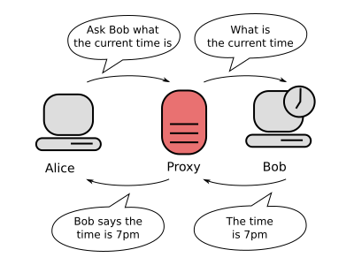
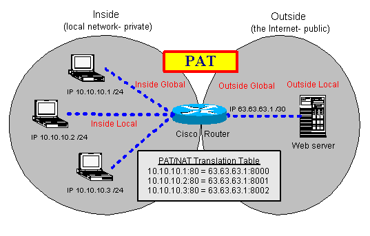
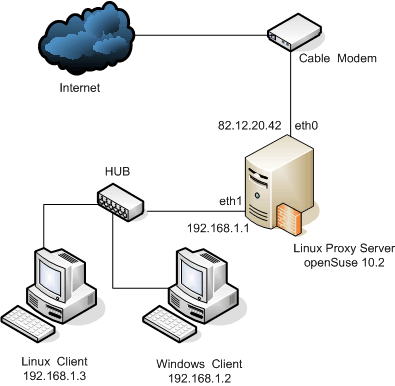

COMPARTIR INTERNET Y ENRUTAMIENTO
=================================

PREGUNTAS
---------

 01. **¿En qué consiste un Proxy? ¿y SOCKS? ¿y PAT? ¿y el redireccionamiento de puertos?**

     Un proxy es un servidor que actúa como intermediario para las peticiones de clientes que buscan recursos en otros servidores. El cliente se conecta al proxy pidiendo algún servicio (fichero, página web, …) disponible en otro servidor y, si el proxy da por válida la petición, entonces es el mismo proxy el que se conecta al servidor para solicitar el recurso y dárselo al cliente. Si el proxy sirve el recurso sin conectarse al servidor, entonces hablamos de un proxy-caché.

     

     SOCKS es el protocolo que facilita el enrutado de paquetes entre cliente y servidor a través de un proxy.

     La traducción de direcciones de red NAT, también conocida como enmascaramiento de IPs, es una técnica mediante la cual las direcciones fuente o destino de los paquetes IP son sustituidas por otras, normalmente traduciendo las direcciones privadas de los clientes en direcciones públicas para que puedan salir a internet. Posteriormente el proxy, cuando recibe la información solicitada por los clientes en la dirección pública, la transforma de nuevo en la dirección privada del cliente que lanzó la petición.

     La traducción de direcciones de puerto PAT, es una técnica muy parecida a NAT, en la que tan sólo tenemos una dirección pública para salir al exterior pero varias direcciones privadas en los clientes, y en la que en los paquetes no sólo se modifican sus direcciones IP sino también sus puertos.

     PAT también permite conexiones desde el exterior a direcciones privadas de nuestra red ("abrir puertos del router"), ya que en una tabla PAT podemos establecer que cuando el proxy reciba información a un determinado puerto, la reenvíe a una dirección privada a otro puerto ("redireccionamiento de puertos" o "port forwarding"). Dichas conexiones del exterior al interior, son imprescindibles  cuando hemos instalado un servidor en nuestra red doméstica y queremos que clientes se conecten des de el exterior.

     

 02. **¿Qué ventajas proporciona un proxy? ¿Por qué? ¿Qué desventajas proporciona? ¿Por qué?**

     Las ventajas de un proxy son: anonimato de los clientes, aumento de velocidad de respuesta al cachear las peticiones, posibilidad de establecer filtrado de red y de loguear las conexiones, posibilidad de evadir el filtrado de red, posibilidad de modificar información de las conexiones, ... La desventaja es que pueden haber problemas de privacidad, proxys externos que inyectan código javascript malicioso, ...

     Las ventajas de un router no vienen tanto del enrutamiento en sí, sino de otros servicios que podemos instalar en la misma máquina: monitorización del tráfico de red, cortafuegos, sistema de detección de intrusos, balanceo de carga entre dos o más conexiones a Internet, proxy-caché, ...

     

 03. **Dibuja el esquema de una red local donde se comparte la conexión a Internet a través de un Proxy.**

     Puede estar en cualquier lugar de la red, incluso en el router.

     

 04. **¿Viene algún software de proxy con Windows Server? ¿Cuál es el software comercial de Proxy más conocido para Windows? ¿Qué funcionalidades trae?**

     No viene ningún software de proxy con Windows Server. Microsoft proporcionaba una solución de pago, [ISA Server](https://en.wikipedia.org/wiki/Microsoft_Forefront_Threat_Management_Gateway), que traía un proxy para HTTP.

     Como proxy comercial [Wingate](https://www.wingate.com/) es bastante conocido, aunque no hay un proxy que sea el más popular. Una lista donde encontrar algunos proxy gratuitos es <http://www.malavida.com/windows/cat/proxy> .

 05. **¿Viene alguna manera de compartir la conexión a Internet de un equipo con Windows Server? ¿Desde dónde se instala y desde dónde se administra?**

     En Windows se puede compartir la conexión de un equipo que tenga dos tarjetas de red, una de ellas con salida a internet. Se instala desde *"Panel de control -> Conexiones de red e Internet -> Conexiones de red -> (seleccionar conexión a internet) -> propiedades -> avanzadas -> habilitar internet compartida"*. A partir de dicho momento dicho ordenador servirá direcciones mediante DHCP a los ordenadores de la red local, y será él la puerta de salida.

 06. **¿Cuál es la manera de compartir la conexión a Internet en Unix/Linux?**

     Mediante los módulos para filtrado, manipulación y redireccionamiento de paquetes de red que vienen en los núcleos de los sistemas operativos. En Linux seria mediante *IPTables* y *NFTables*, que son las aplicaciones que permiten a un administrador establecer reglas de filtrado y modificación de paquetes de red para *Netfilter*, el módulo del núcleo Linux que se ocupa de ello.

     Y si queremos servidores proxy, tenemos *[Squid](https://www.squid-cache.org/)*, muy completo y potente, o *[TinyProxy](https://tinyproxy.github.io/)*, mucho más sencillo y ligero.

 07. **Al instalar un servicio de proxy, ¿Qué parámetros a configurar piensas que serán los más importantes?**

     Qué puertos filtramos y cuales no.

 08. **Una red está protegida para evitar el acceso web a páginas de piratería, pornografía, ... Comenta como funcionaría cada uno de estos métodos para sobrepasar dicha protección:**

     a) Algún proxy anónimo (encontraréis muchos en <http://proxy.org/> .

     b) Algún traductor de páginas web (
        [Google Translator](http://translate.google.com/) ,
        [Bing Translator](https://www.bing.com/translator) ,
        [DeepL](https://www.deepl.com/en/translator) , ...).

     c) Navegador+Tor (por ejemplo [Tor Browser](https://www.torproject.org/)).

     Los tres métodos son efectivos.

     En el primero (a) pedimos la página web a visitar a un ordenador intermediario, pero puede ser que las páginas más famosas de proxy estén filtradas.

     El segundo (b) funciona como el primero. También pedimos la página web a visitar a un ordenador intermediario (que la traduce), y que no acostumbra a estar filtrado.

     El tercero (3) siempre es efectivo, a menos que los puertos de comunicación utilizados por Tor estén filtrados por algún cortafuegos. Con este método nuestras peticiones web se redirigen, no ya a través de una máquina intermediaria, sino a través de toda una red de máquinas intermediarias que se pasan la información unas a otras.

DATOS DE LA PRÁCTICA LINUX Y WINDOWS
------------------------------------

El ordenador o máquina virtual que haga de router deberá tener dos tarjetas de red.

  - Una tarjeta conectada a la red interna y con la IP fija 192.168.100.1, que es precisamente la dirección de gateway especificada en los otros ordenadores de la red.

  - Otra tarjeta conectada a la red externa o internet.

PRÁCTICA WINDOWS
----------------

 01. Manipula la configuración de las tarjetas de red de la máquina virtual del router para que tenga dos tarjetas de red, una conectada a la red interna y otra a internet mediante NAT.

 02. La tarjeta de red conectada a la red interna debe tener como IP la dirección del gateway de la red:

     Panel de control -> conexiones de red -> (escoger conexión) -> propiedades -> TCP/IP -> dar los parámetros TCP/IP estáticos que dice el enunciado

 03. Instala algun software de proxy para Windows (por ejemplo [AnalogX](http://www.analogx.com/contents/download/network/proxy.htm)). Exploraremos la interfaz gráfica de administración del servicio, configurando los parámetros básicos.

 04. Prueba el servicio desde un cliente de la red interna.

PRÁCTICA LINUX
--------------

 01. Manipula la configuración de las tarjetas de red de la máquina virtual del router para que tenga dos tarjetas de red, una conectada a la red interna y otra a internet mediante NAT.

 02. Instala Linux en la máquina. La tarjeta de red conectada a la red interna debe tener como IP la dirección del gateway de la red. (Antes de escribir los datos comprobad cual es el nombre de dicha tarjeta de red ya que puede no ser *enp0s3*).

         # ip addr

         # nano /etc/network/interfaces

             auto enp0s3
             iface enp0s3 inet static
               address   192.168.100.1
               netmask   255.255.255.0

         # nano /etc/resolv.conf

             domain       mired.org
             nameserver   192.168.100.2
             nameserver   8.8.8.8

         # nano /etc/hostname

             Panoramix

     y a continuación reinicia la red:

         # systemctl restart networking

 03. Configura la máquina para que haga de router, escribiendo para ello un pequeño script que se ejecute al inicio (en este script supongo que la tarjeta de red conectada a internet es *enp0s8*):

         # nano /root/enrutamiento.sh

             #!/bin/sh
             echo "1" > /proc/sys/net/ipv4/ip_forward
             iptables -A FORWARD -j ACCEPT
             iptables -t nat -A POSTROUTING -s 192.168.100.0/24 -o enp0s8 -j MASQUERADE

         # chmod +x /root/enrutamiento.sh

     y a continuación estableced que el servicio se inicie con el ordenador. Tenemos tres maneras de hacerlo.

     a) La manera antigua, con el sistema de arranque init seria:

         # mv /root/enrutamiento.sh /etc/init.d/enrutamiento.sh

         # update-rc.d enrutamiento.sh defaults

     b) La manera moderna, con el sistema de arranque systemd seria:

         # nano /etc/systemd/system/enrutamiento.service

             [Unit]
             Description=Enrutamiento systemd service

             [Service]
             Type=simple
             ExecStart=/bin/bash /root/enrutamiento.sh

             [Install]
             WantedBy=multi-user.target

         # systemctl start enrutamiento

         # systemctl status enrutamiento

         # systemctl enable enrutamiento

     c) Pero en Debian y Ubuntu tenemos una tercera manera. Cuando tenemos reglas de cortafuegos que están funcionando bien, si instalamos el paquete `iptables-persistent`, dichas reglas se harán persistentes y se cargarán en cada nuevo arranque del equipo:

         # apt install iptables-persistent

 04. Prueba el servicio desde un cliente de la red interna:

         $ ping www.google.es

     Si encuentras errores, comprueba las tablas de enrutamiento en el servidor, con el comando route.

 05. Una opción alternativa a los puntos 2 y 3 sería instalar una [distribución especializada en hacer de router/gateway](http://en.wikipedia.org/wiki/List_of_router_or_firewall_distributions).

     Las más famosas son *[IPFire](https://www.ipfire.org/)* (sencilla y basada en Linux) , *[OPNsense](https://opnsense.org/)* y *[pfSense](https://www.pfsense.org/)* (completas y basadas en FreeBSD). Escojo *IPFire*.

     Al instalarse, las dos cosas que debemos tener claras al contestar son que:

     a) la tarjeta de red conectada a internet es la "roja" ("red") y recibe la IP y el resto de parámetros de red por DHCP;

     b) la tarjeta de red conectada a nuestra red local es la "verde" ("green") y le daremos la dirección IP del gateway de la red.

     Si una vez instalado deseamos modificar dichos parámetros, debemos acceder a una sesión como usuario `root` y ejecutar el comando `setup`.

     Para administrar remotamente IPFire desde un navegador web debemos introducir la URL <https://dirección_IPFire:444/>

Un ejercicio adicional puede ser interceptar el tráfico de una red local mediante [arp spoofing](https://es.wikipedia.org/wiki/Suplantaci%C3%B3n_de_ARP). Para ello, además de establecer las correspondientes normas de redireccionamiento, también hay que:

  - Añadir a la tarjeta de red una segunda IP con la IP de la puerta de enlace:

        # ip addr add 192.168.100.1/24 dev enp0s3

  - Envenenar las tablas ARP de los equipos de la red, colocando nuestra dirección MAC como dirección MAC del falso gateway:

        # arping -c 3 -A -I enp0s3 192.168.100.1

REFERENCIAS
-----------

  - <http://en.wikipedia.org/wiki/Proxy_server>

  - <http://en.wikipedia.org/wiki/SOCKS>

  - <http://en.wikipedia.org/wiki/Network_address_translation>

  - <http://en.wikipedia.org/wiki/Port_address_translation>

  - <http://en.wikipedia.org/wiki/Port_forwarding>
